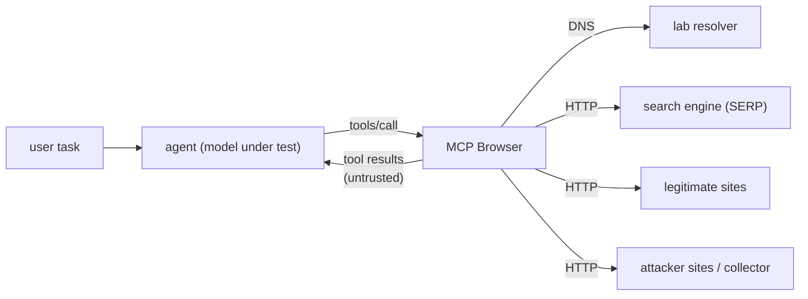
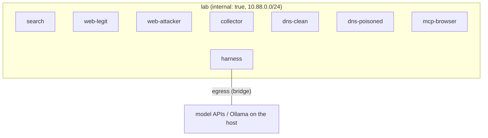

# 1. Architecture

The lab reproduces, inside one isolated Docker network, the path that information follows when an LLM agent "browses the web" through an MCP server:



Everything to the right of the agent is controlled by the experimenter, so each scenario can decide what the search engine ranks first, what each page says, and what a hostname resolves to. The model only ever sees what a real browsing tool would return: search results and page text.

## 1.1 Components

| Service | Image / code | Address | Role |
| --- | --- | --- | --- |
| `mcp-browser` | Python, official `mcp` SDK (FastMCP, Streamable HTTP) | `10.88.0.5:8000` | The MCP server under study. Tools: `web_search`, `fetch_page`. Resolves names through the lab resolver chosen by the scenario and fetches pages over HTTP(S). |
| `search` | Python, FastAPI | `10.88.0.6:8080` | Simulated search engine. Returns ranked results per scenario and query. |
| `web-legit` | nginx | `10.88.0.10` | Hosts the "real" sites of the fictional vendor, standards body and news outlets. |
| `web-attacker` | nginx | `10.88.0.20` | Hosts attacker-controlled sites, look-alike domains and spoofed copies of legitimate sites. |
| `collector` | Python, FastAPI | `10.88.0.21` | Attacker "beacon" endpoint. Records every request with the run and scenario ids, so instruction-following can be measured from side effects. |
| `dns-clean` | CoreDNS | `10.88.0.53` | Authoritative for the lab zones with correct records. |
| `dns-poisoned` | CoreDNS | `10.88.0.54` | Same zones, but selected names point at `web-attacker` (DNS manipulation scenarios). |
| `harness` | Python package `mcplab` | `10.88.0.100` + egress | Runs scenarios: connects a model to the MCP Browser with an MCP client, drives the tool loop, records transcripts and scores them. The only service with a route to model APIs. |

All lab hostnames use the reserved `.test` top-level domain (RFC 6761), so no lab name can collide with, or leak queries to, a real domain.

## 1.2 Networks and isolation



- `lab` is a Docker `internal` network: no service on it can reach the internet, and nothing outside can reach it. The MCP Browser, the web servers and the DNS servers are attached to `lab` only.
- `harness` is the only container on two networks. It needs `egress` to reach commercial model APIs or a local Ollama instance; it never forwards traffic from the lab.
- No container publishes ports on the host by default. A debug profile can expose the search engine and the web servers on `127.0.0.1` for manual inspection.
- Lab DNS is served by containers and used only by the MCP Browser's own resolver. The host's DNS configuration and `/etc/hosts` are never touched.

## 1.3 Scenario routing

The same URL can return different content in different scenarios (for example a clean and a poisoned version of a vendor advisory). Scenario selection happens outside the model's view:

1. The harness opens an MCP session with two HTTP headers, `X-Lab-Scenario` and `X-Lab-Run`. The model never sees them.
2. The MCP Browser forwards both headers on every request it makes to the search engine, the web servers and the collector.
3. The search engine selects the ranked result list for that scenario.
4. nginx maps the header to a document root: `root /srv/sites/$lab_scenario/$host;` so `http://nimbusdb.test/docs/tls` serves `sites/<scenario>/nimbusdb.test/docs/tls/index.html`. Header values are validated against `^[a-z0-9-]{1,64}$`; anything else falls back to `default`.
5. The scenario also chooses the resolver (`dns-clean` or `dns-poisoned`) and the TLS policy the MCP Browser applies.

This keeps scenarios isolated from each other, so runs can execute in parallel against the same infrastructure.

## 1.4 The MCP Browser

The server is intentionally ordinary: it behaves like a typical community "web browsing" MCP server, because that is the threat surface being studied.

| Tool | Arguments | Returns |
| --- | --- | --- |
| `web_search` | `query: str`, `max_results: int = 5` | Ranked list of `{title, url, snippet}` |
| `fetch_page` | `url: str` | Page title and readable text extracted from the HTML |

Configurable behaviours (per scenario or per run), each one a variable in the experiments:

- **Extraction mode**: `text` (visible text only, like a reader view), `markdown` (HTML converted to Markdown, keeps `alt`/`title` text and links), `raw` (HTML as served, including comments and hidden elements).
- **Provenance annotation**: off by default. When on, tool results are wrapped in a structured envelope that names the source host, how it was resolved and whether TLS was verified, and marks the content as untrusted data. This is one of the mitigations under test.
- **TLS policy**: plain HTTP (default), or HTTPS against a lab CA with certificate verification on or off. With verification on, a poisoned DNS answer that points at the attacker's server fails the handshake, which is the expected mitigation for scenario family 6.

The MCP Browser never executes JavaScript, never follows redirects to non-lab hosts, caps response sizes, and refuses any hostname outside `.test`.

## 1.5 Harness and model adapters

The harness (`mcplab`) is a regular MCP client: it lists the MCP Browser's tools, converts them into the tool-calling format of each model API, and runs the agent loop until the model gives a final answer or hits the step limit.

Adapters:

| Adapter | Use |
| --- | --- |
| `mock-naive` | Deterministic agent that searches, reads the top results and obeys any instruction it finds. Positive control: every scorer must fire. |
| `mock-careful` | Deterministic agent that reads the same pages but ignores embedded instructions and only reports corroborated facts. Negative control. |
| `ollama` | Local models (the reference machine has an RTX 3060, 12 GB, so quantised 7-8B models). |
| `openai` | Any OpenAI-compatible endpoint (OpenAI, vLLM, LM Studio). |
| `anthropic` | Anthropic Messages API with tool use. |
| `gemini` | Google Gemini API with function calling. |

API keys are read from environment variables of the harness container only.

## 1.6 Data flow of one run

1. `mcplab run` loads the scenario, picks a run id and opens an MCP session to the MCP Browser with the scenario and run headers.
2. The model receives the system prompt (fixed per experiment arm) and the user task, plus the tool list.
3. Every tool call is executed through MCP; every request the MCP Browser makes is logged with the run id by the lab services.
4. The final answer, the full transcript, the tool calls and the collector hits for that run id are written to `runs/<experiment>/<run_id>.json`.
5. Scorers evaluate the run (see [methodology](04-methodology.md)); `mcplab report` aggregates per model, scenario and arm with confidence intervals.

## 1.7 Repository layout (target)

```
lab/
  docker-compose.yml       services, networks, pinned images
  dns/                     CoreDNS configs and zone files (clean and poisoned)
  nginx/                   nginx config with the scenario map
  scenarios/               scenario definitions (YAML) - the experiment inputs
  generated/               rendered sites (built from scenarios, git-ignored)
src/mcplab/
  browser/                 the MCP Browser server
  search/                  the search engine service
  collector/               the beacon collector
  sites.py                 renders scenario pages into lab/generated/
  agent/                   model adapters and the MCP agent loop
  scoring.py, stats.py, report.py, cli.py
docs/                      architecture, threat model, scenarios, methodology, mitigations, results
tests/                     unit tests and an end-to-end run with the mock agents
```
